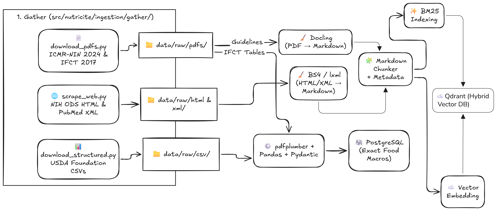

# 🥗 NutriCite

**NutriCite** is an evidence-based Nutrition & Diet Assistant. It combines exact food macro calculations with cited clinical guidelines so users get accurate dietary advice without LLM hallucinations.

---

## Step 1: Data Ingestion Architecture

### 📚 What Data We Gather
* **Clinical Guidelines (Unstructured $\rightarrow$ Qdrant):**
  * **ICMR-NIN 2024 (PDF):** Official Indian dietary guidelines, balanced plates, and RDAs.
  * **NIH ODS Fact Sheets (HTML):** Micronutrient dosages, deficiencies, and upper limits.
  * **PubMed Central (XML):** Meta-analyses on Type 2 Diabetes, Hypertension, and PCOS.
* **Food & Nutrition Data (Structured $\rightarrow$ PostgreSQL):**
  * **USDA FoodData Central (CSV):** Exact macro and micronutrient values for global foods.
  * **IFCT 2017 (PDF Tables):** Exact nutrient composition for 528+ Indian foods and spices.

### 🛠️ How the Gather Scripts Work
* [`download_pdfs.py`](src/nutricite/ingestion/gather/download_pdfs.py)
  * **What:** Official nutrition guidelines and food-composition reports, saved as PDFs with a source manifest.
  * **Why:** Keep trusted documents available for later text extraction and citation.
  * **How:** **httpx** streams each download, tries fallback URLs when needed, and checks the PDF signature. The manifest records publisher, year, topic, and SHA-256 hash to identify each source and detect file changes.
* [`download_structured.py`](src/nutricite/ingestion/gather/download_structured.py)
  * **What:** USDA and Open Food Facts nutrition data, FDA drug-label information, and optional Kaggle recipe datasets.
  * **Why:** Store food nutrients and food–drug safety details in structured files for exact lookup and analysis.
  * **How:** **httpx** fetches web data and archives; Python's **zipfile** and **csv** libraries extract and write datasets as CSV/JSONL. The **Kaggle CLI** handles optional recipe downloads, and a manifest records download status and source details.
* [`scrape_web.py`](src/nutricite/ingestion/gather/scrape_web.py)
  * **What:** Health guidance pages, PubMed abstracts, and available PMC full-text research.
  * **Why:** Collect evidence that can be searched and cited alongside the structured food data.
  * **How:** **httpx** retrieves pages and research records; **Beautiful Soup** with **lxml** cleans HTML, while **lxml** parses research XML. The script saves source files plus cleaned Markdown and structured records.

### 🧹 How the Parse Scripts Work
* [`pdf_to_md.py`](src/nutricite/ingestion/parse/pdf_to_md.py)
  * **What:** Converts text-based guideline PDFs into Markdown files under `data/clean/text/`. The IFCT food-composition PDF is skipped because it is handled separately.
  * **Why:** Markdown is easier to inspect and prepare for later search than raw PDF layout.
  * **How:** **Docling** converts most PDFs; **pypdfium2** extracts page text from one large PDF using a faster path. OCR is disabled, so scanned/image-only text may not be extracted.
* [`html_to_md.py`](src/nutricite/ingestion/parse/html_to_md.py)
  * **What:** Converts saved NIH HTML pages and PubMed abstracts into Markdown.
  * **Why:** Remove webpage clutter and put guidance and research abstracts into a consistent, readable format.
  * **How:** **Beautiful Soup** with **lxml** removes navigation and extracts headings, paragraphs, lists, and tables. **lxml** also parses PubMed XML; existing PubMed JSON can be read directly.
* [`clean_food_csv.py`](src/nutricite/ingestion/parse/clean_food_csv.py)
  * **What:** Combines selected USDA nutrients and IFCT food records into `data/clean/csv/foods_clean.csv`.
  * **Why:** Give food records from different sources a consistent schema for exact lookup.
  * **How:** **pandas** joins and reshapes USDA CSVs, **pdfplumber** extracts IFCT tables, and **Pydantic** validates the normalized records. Only mapped nutrients are included; missing values are set to zero.

## Step 2: Contextual Hybrid Indexing (Planned)

### 🔀 Why Dual-Track (PostgreSQL + Qdrant)?
Vector databases are terrible at exact math. Instead of dumping calorie tables into a vector store, NutriCite splits the pipeline:
* **PostgreSQL** handles exact numbers (calories, protein, sodium, allergens) via deterministic SQL queries.
* **Qdrant** handles unstructured medical text for clinical reasoning and cited explanations.

### 🔍 Why Hybrid Search (Vector Embeddings + BM25)?
Every clinical text chunk is indexed with both methods in Qdrant:
* **Vector Embeddings (Dense)** understand meaning and synonyms (e.g., *"high blood sugar"* matches *"glycemic control"*).
* **BM25 (Sparse)** locks onto exact medical terms, biomarkers, and drug names (e.g., *"HbA1c"*, *"Vitamin B12"*, *"Metformin"*).